# Deep Ricochet

<p align="center">
  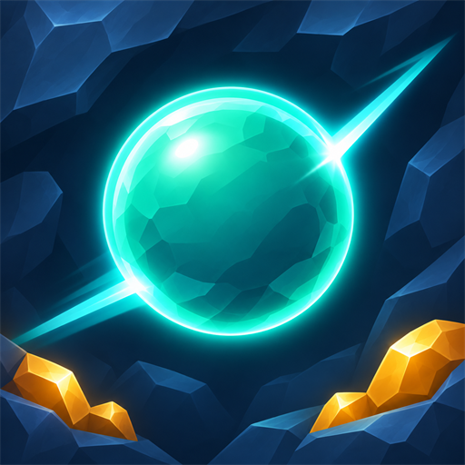
</p>

Deep Ricochet, dikey ekranda oynanan; nişan alma, sekme fiziği ve rota seçimi üzerine kurulu bir maden oyunudur. Oyuncu sekiz topluk yaylımları duvarlardan ve bloklardan sektirerek odanın çekirdeğini kırmaya çalışır. Her atış sınırlı olduğu için doğru açı, blokların kırılma sırası ve riskli rota tercihleri doğrudan sonucu belirler.

Proje tek oyunculu ve çevrimdışı çalışır. Türkçe ve İngilizce arayüz, otuz beş maden, günlük mücadele, puan tabanlı yıldız ilerlemesi, iki kalite modu ve beş mağara renk teması içerir.

<table>
  <tr>
    <td align="center"><strong>35</strong><br>Maden</td>
    <td align="center"><strong>259</strong><br>Doğrulanan oda</td>
    <td align="center"><strong>11</strong><br>Blok türü</td>
    <td align="center"><strong>5</strong><br>Renk teması</td>
    <td align="center"><strong>TR / EN</strong><br>Arayüz</td>
  </tr>
</table>

## Oynanış

Bir normal maden koşusu dört odadan oluşur. İlk oda doğrudan başlar; başarılı olunan her odadan sonra sıradaki oda için iki rota sunulur:

- **Geniş Geçit:** Daha açık yerleşime ve `×1,0` puan çarpanına sahip güvenli rota.
- **Dar Damar:** Daha sıkışık kaya duvarları ve zengin blok yerleşimi karşılığında `×1,5` puan çarpanı sunan riskli rota.

Oyuncu ekrana basılı tutup sürükleyerek atış yönünü belirler. Kesikli nişan önizlemesi, gerçek atışla aynı çarpışma simülatörünü kullanır ve ilk sekmeleri gösterir. Parmak bırakıldığında sekiz top aynı noktadan `0,08` saniye aralıklarla çıkar. Toplar duvarlardan ve sert kayalardan seker, kırılabilir bloklara hasar verir ve alt sınıra ulaştığında toplanır.

Normal odalarda üç atış hakkı vardır. Çekirdek bu haklar bitmeden kırılırsa oda tamamlanır; aksi durumda koşu sona erer. Başarılı bir madenin sonuç ekranından sonraki madene geçilebilir, aynı maden yeniden başlatılabilir veya ana menüye dönülebilir. **Aynı Madeni Dene** seçeneği aynı seed'i koruyarak aynı başlangıç ve rota dizilimini tekrar üretir.

Oyun sırasında simülasyon `1×` ve `2×` arasında değiştirilebilir. `2×` modu fizik kurallarını değiştirmez; her görüntü karesinde iki sabit simülasyon adımı çalıştırır. Böylece sonuçlar hız seçiminden bağımsız kalır.

## Madenler ve zorluk

Oyunda sırayla açılan otuz beş maden bulunur. Her madende bir başlangıç, üç geniş geçit ve üç dar damar olmak üzere yedi şablon; toplamda 245 normal oda vardır. Bir koşu bu havuzdan seed tabanlı ve tekrar etmeyen dört oda seçer. Günlük maden için ayrıca on dört yoğun varyant üretilir.

- **Maden 1–6:** Normal blok, cevher, sert kaya, çekirdek ve tek atışlık top kutularını kullanır.
- **Maden 7–10:** Çatlak kaya ve patlayıcı bloklar devreye girer.
- **Maden 11–14:** Zırhlı bloklar yerleşimlere eklenir ve zayıf nokta kullanımı öğretilir.
- **Maden 15–18:** Yankı blokları devreye girer; uzaktaki eş bloklar aynı doğrudan vuruştan etkilenir.
- **Maden 19–22:** Zırhlı, yankılı, çatlak ve patlayıcı blokların birlikte kullanıldığı daha yoğun karışımlar başlar.
- **Maden 23–28:** Işık kristalleri, tek zayıf noktalı zırhlılar ve daha kapalı çekirdek yollarıyla ustalık bölümü oluşur.
- **Maden 29–35:** Bir veya iki asit varili, odanın farklı bölgelerinde çevresindeki blokları katmanlı hasarla etkiler.

Maden seviyesi yükseldikçe önce blok yoğunluğu ve ortalama dayanıklılık, ilerleyen bölümlerde ise özel blok oranı, zırhlı blok sayısı ve çekirdeğin koruma katmanı artar. Çekirdek yalnızca merkezde bulunmaz; üst bölgenin sol, orta veya sağ tarafında, kırılabilir blokların arkasında yer alabilir. Atıcının çevresini açık tutmak için 8×10 oyun ızgarasının en alt iki satırına blok yerleştirilmez.

Dar damarlar geniş geçitlerden yalnızca sayı bakımından değil, geometri bakımından da ayrılır. Yanlardaki sert kaya yığınları yolu tek hücrelik bir geçide kadar daraltabilir; değerli bloklar üst bölgede toplanır ve çekirdeğe doğrudan erişim zorlaştırılır.

### Yıldız sistemi

Başarıyla bitirilen her normal maden en az bir yıldız verir. Her madenin içerik tanımında ayrı tutulan iki puan eşiği aşıldığında sonuç iki veya üç yıldıza yükselir. Böylece süre ya da cihaz performansı değerlendirmeye katılmaz; kırılan bloklar, kalan atış bonusu ve rota çarpanı doğrudan yıldız sonucunu belirler. Maden seçim ekranı kazanılan en yüksek yıldızı gösterir ve daha düşük puanlı tekrarlar eski yıldız derecesini azaltmaz.

## Bloklar

Blokların ortasındaki sayı kalan canı gösterir. Topla doğrudan temas çoğu bloğa bir hasar verir. Aşağıdaki görseller oyunda kullanılan temel assetlerdir; seçilen renk teması bu görselleri çalışma anında yeniden renklendirir.

<table>
  <thead>
    <tr>
      <th>Görsel</th>
      <th>Blok</th>
      <th>Can</th>
      <th>Puan</th>
      <th>Davranış</th>
    </tr>
  </thead>
  <tbody>
    <tr>
      <td>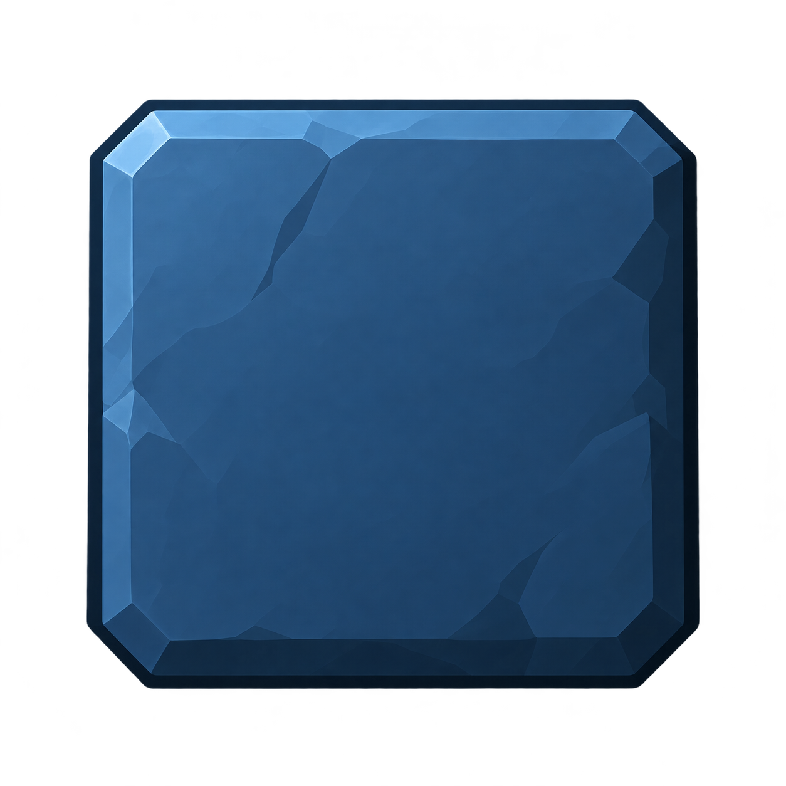</td>
      <td><strong>Normal blok</strong></td>
      <td>2–8</td>
      <td>10</td>
      <td>Temel kırılabilir bloktur. İlerleyen madenlerde dayanıklılığı yükselir.</td>
    </tr>
    <tr>
      <td>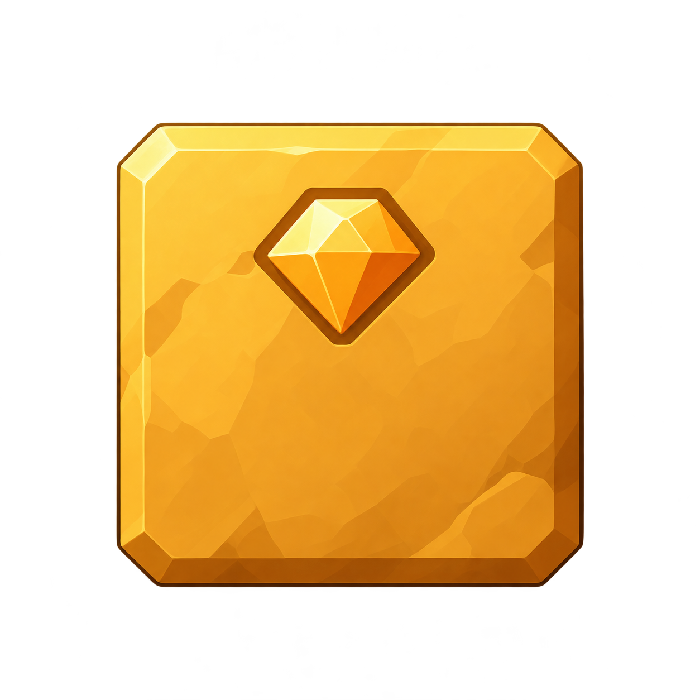</td>
      <td><strong>Cevher</strong></td>
      <td>3–8</td>
      <td>25</td>
      <td>Normal bloktan daha değerlidir ve kendine özgü vuruş sesi kullanır.</td>
    </tr>
    <tr>
      <td>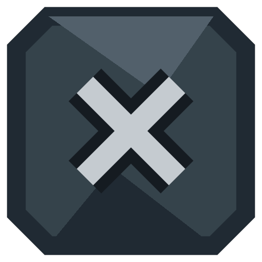</td>
      <td><strong>Sert kaya</strong></td>
      <td>Kırılamaz</td>
      <td>0</td>
      <td>Topu yansıtır. Patlamadan da hasar almaz ve özellikle dar damarlarda yolu biçimlendirir.</td>
    </tr>
    <tr>
      <td>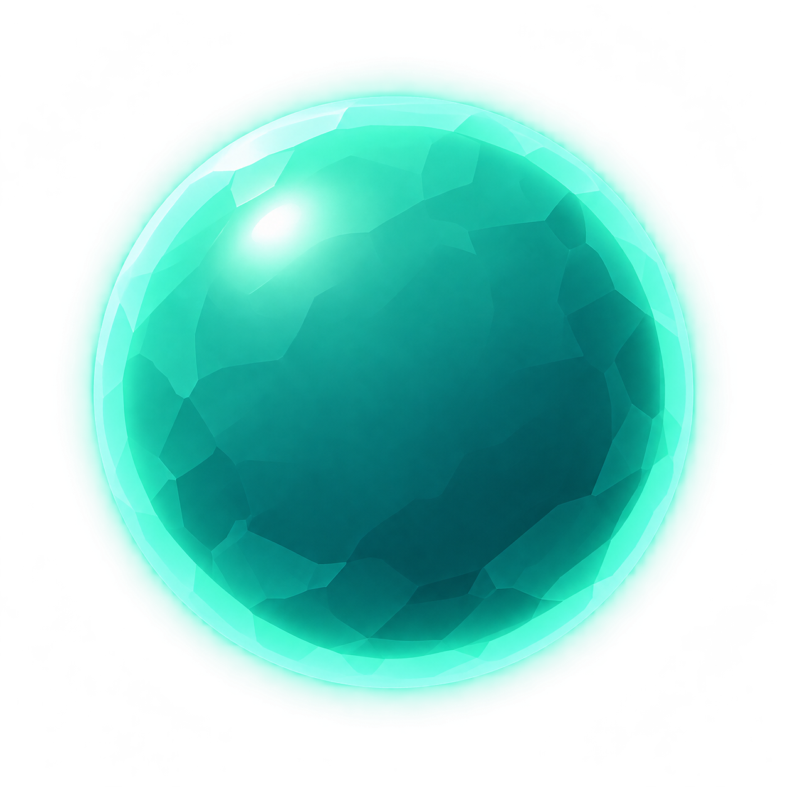</td>
      <td><strong>Çekirdek</strong></td>
      <td>6–8</td>
      <td>100</td>
      <td>Odanın ana hedefidir. Görseli yuvarlak olsa da fizik alanı diğer hücreler gibi karedir.</td>
    </tr>
    <tr>
      <td>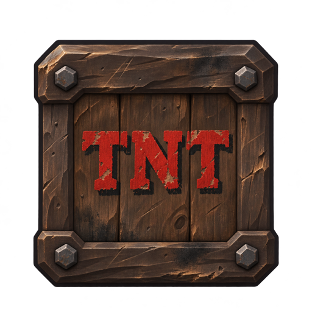</td>
      <td><strong>Patlayıcı</strong></td>
      <td>2–8</td>
      <td>10</td>
      <td>Kırılınca merkezinin çevresindeki 5×5 alana üç hasar verir. Başka bir patlayıcıyı kırarsa zincirleme patlama başlatır.</td>
    </tr>
    <tr>
      <td>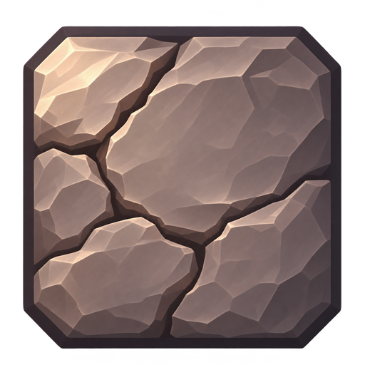</td>
      <td><strong>Çatlak kaya</strong></td>
      <td>8</td>
      <td>6</td>
      <td>Her madende aynı dayanıklılığa sahip, düşük puanlı bir engeldir.</td>
    </tr>
    <tr>
      <td>
        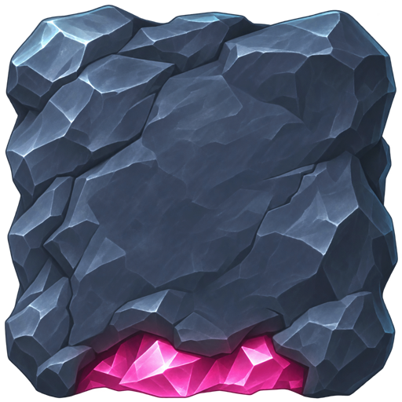
        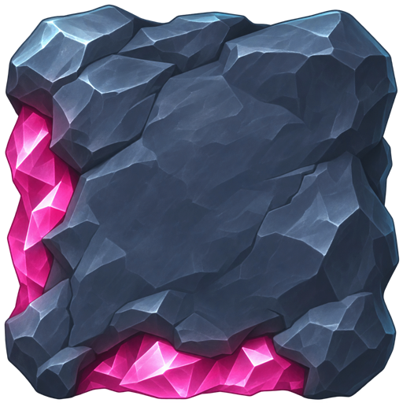
        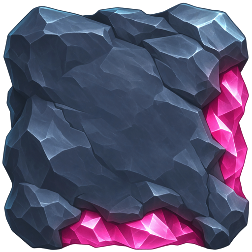
      </td>
      <td><strong>Zırhlı blok</strong></td>
      <td>3–8</td>
      <td>40</td>
      <td>Yalnız pembe gösterilen bir veya iki açık kenardan doğrudan hasar alır. Yerleşim doğrulaması bu kenarların duvarla ya da başka blokla kapanmasını engeller.</td>
    </tr>
    <tr>
      <td>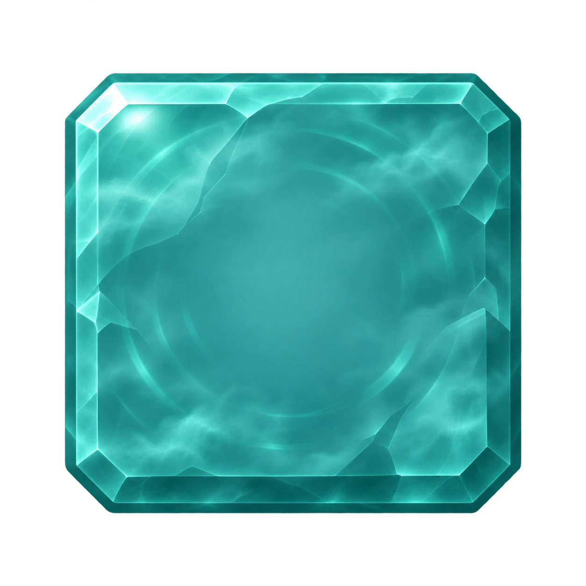</td>
      <td><strong>Yankı bloğu</strong></td>
      <td>6</td>
      <td>18</td>
      <td>Topun doğrudan temas ettiği her vuruşta odadaki diğer yankı bloklarına bir hasar iletir. İletilen hasar yeni bir yankı başlatmaz.</td>
    </tr>
    <tr>
      <td>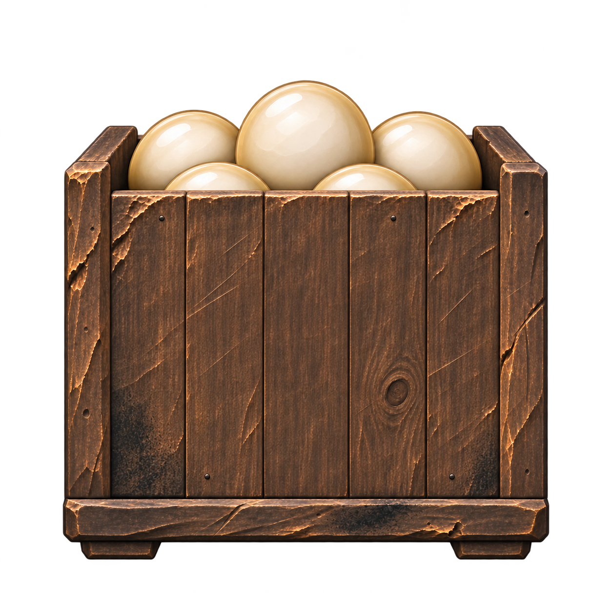</td>
      <td><strong>Top kutusu</strong></td>
      <td>4</td>
      <td>15</td>
      <td>Kırıldığında yalnızca sonraki atışa iki top ekler. Aynı odada bonus en fazla dört olur; kullanıldıktan veya oda değiştikten sonra sıfırlanır.</td>
    </tr>
    <tr>
      <td>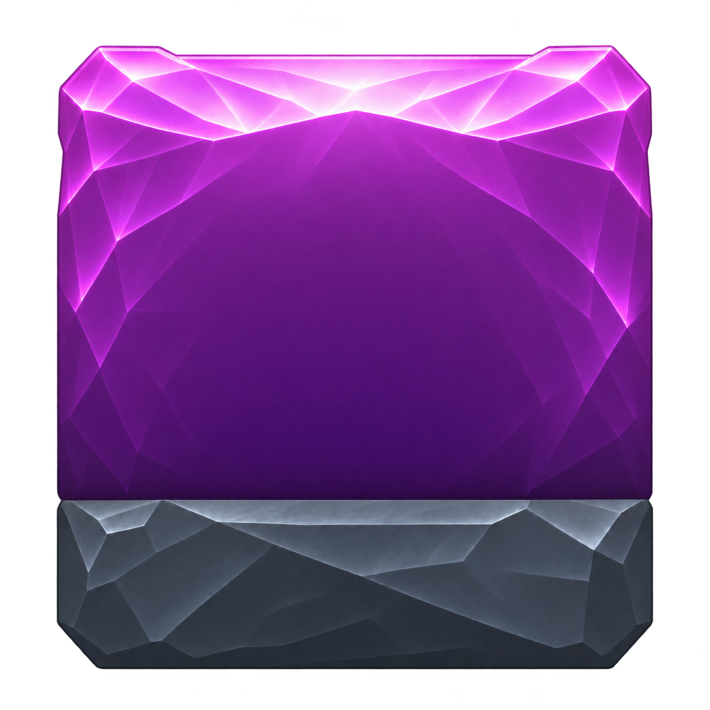</td>
      <td><strong>Işık kristali</strong></td>
      <td>7</td>
      <td>30</td>
      <td>Kırıldığında sivri ucunun baktığı satır ya da sütuna ışın gönderir ve yolundaki kırılabilir bloklara iki hasar verir. Sert kayadan geçer fakat ona hasar vermez.</td>
    </tr>
    <tr>
      <td>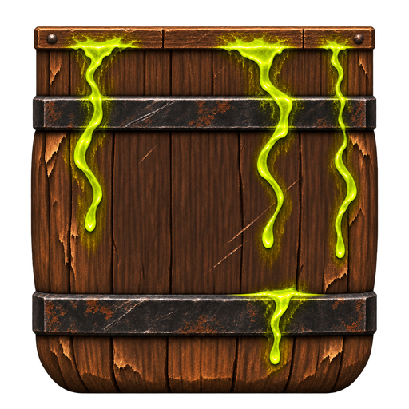</td>
      <td><strong>Asit varili</strong></td>
      <td>9</td>
      <td>20</td>
      <td>Kırıldığında 7×7 alana yayılır: yakın 3×3 bölgeye 5, 5×5 halkasına 3 ve dış halkaya 1 hasar verir. Sert kaya etkilenmez; zırhlı blok yalnızca 1 hasar alır.</td>
    </tr>
  </tbody>
</table>

Patlama ve ışık kristali ışını zırhlı bloğun kapalı kenarlarını aşar; sert kayayı ise etkileyemez. Patlama, yankı, ışın veya asitle kırılan bütün puanlı bloklar normal kırılma puanlarını verir. Işık kristalleri yalnızca arkalarında başka bir blok ya da duvar desteği ve ışın yönlerinde geçerli bir hedef bulunduğunda oda şablonuna yerleştirilir. Top kutusu 15. madenden itibaren normal odalarda bir veya iki adet bulunur; ilk 14 madende yer almaz. Asit varili 29. madenden itibaren odanın uygun hücrelerine en fazla iki adet yerleştirilir.

## Puanlama

Oda puanı, kırılan blokların toplamı ve başarı durumunda kullanılmayan her atış için verilen 20 puan üzerinden hesaplanır. Son değer rota çarpanıyla çarpılır:

```text
oda ödülü = (kırılma puanı + kalan atış × 20) × rota çarpanı
```

Başarısız olunan odada kullanılmayan atış bonusu verilmez. Her odanın kırılma puanı, kalan atış bonusu, çarpanı ve toplam ödülü sonuç geçmişinde ayrı ayrı gösterilir. Her maden seviyesinin en iyi koşu puanı ve tamamlanma sayısı profilde ayrı ayrı saklanır. Ana menüde Devam düğmesinin altında kayıtlı koşunun seviye ve oda bilgisi gösterilir.

## Günlük maden

Günlük maden normal ilerleme zincirinden bağımsız, daha yoğun bir mücadeledir. Yerel takvim tarihinden deterministik bir seed üretilir; aynı gün içindeki tekrarlar aynı oda ve rota dizilimini verir, gün değiştiğinde seed de değişir.

- Her oda 24 blok içerir.
- On bir blok türünün tamamı kullanılır.
- Normal madenlerdeki üç atış yerine beş atış hakkı verilir.
- Maden 28 düzenlerinden türetilen ve aynalanmış eşleriyle birlikte 14 günlük oda bulunur.
- Günlük en iyi puan yalnız o gün için tutulur; yerel tarih değiştiğinde sıfırlanır ve normal maden kilitlerini değiştirmez.

## Renk temaları

Renk teması yalnız arka planı değil; ızgarayı, normal ve özel blokları, sert kayayı, çekirdeği, zırhı ve zırhın zayıf noktalarını birlikte değiştirir. Tema değişimi fizik veya puan değerlerine dokunmaz. Ayrı tema sprite'ları yerine yukarıdaki özgün assetler çalışma anında palete göre renklendirildiği için bütün görseller aynı doku ve biçimi korur.

<table>
  <thead>
    <tr>
      <th>Tema</th>
      <th>Oyundaki blok paleti</th>
      <th>Karakter</th>
    </tr>
  </thead>
  <tbody>
    <tr>
      <td><strong>Derin Safir</strong></td>
      <td>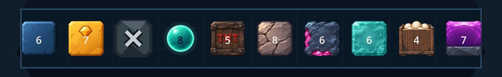</td>
      <td>Lacivert mağara, mavi normal blok, kehribar cevher ve turkuaz çekirdek.</td>
    </tr>
    <tr>
      <td><strong>Ametist Damar</strong></td>
      <td>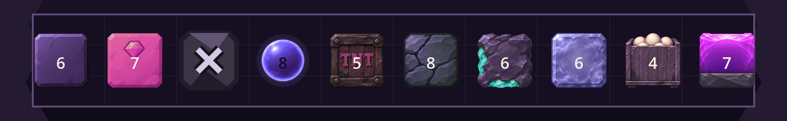</td>
      <td>Koyu mor mağara, pembe cevher, lavanta çekirdek ve camgöbeği zırh açıklığı.</td>
    </tr>
    <tr>
      <td><strong>Volkanik Ocak</strong></td>
      <td>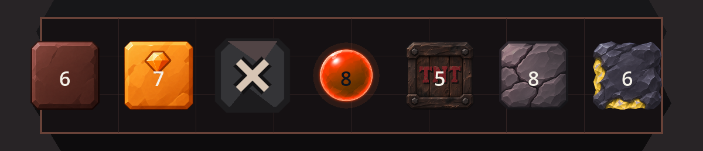</td>
      <td>Kömür tonları, tuğla kırmızısı bloklar, sıcak turuncu çekirdek ve sarı zırh açıklığı.</td>
    </tr>
    <tr>
      <td><strong>Yosunlu Mağara</strong></td>
      <td>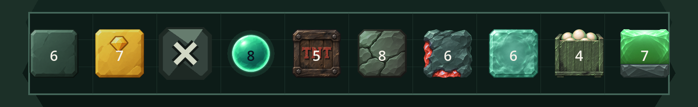</td>
      <td>Orman yeşili taşlar, toprak sarısı cevher, nane yeşili çekirdek ve mercan zırh açıklığı.</td>
    </tr>
    <tr>
      <td><strong>Buzul Madeni</strong></td>
      <td>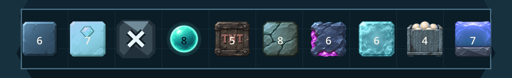</td>
      <td>Buz mavisi mağara, açık cevher, turkuaz çekirdek ve mor zırh açıklığı.</td>
    </tr>
  </tbody>
</table>

Seçilen tema ayarlara kaydedilir ve menü, rota önizlemeleri, öğretici ile oyun alanında ortak olarak uygulanır.

## Ses ve geri bildirim

Çarpışma sesleri her yaylımda sıfırlanan Re minör pentatonik bir dizi kullanır. Normal blok, cevher, sert kaya ve çekirdek farklı ses katmanlarına sahiptir. Çok toplu yaylımlarda seslerin üst üste binmesini önlemek için çarpışmalar 45 milisaniyelik hız sınırıyla oynatılır.

Her blok türünün ayrı kırılma dili vardır: normal blokta mavi parçalar, cevherde altın kıvılcımlar, çatlak kayada keskin kırık çizgileri, patlayıcıda çift şok dalgası, zırhlıda metal ve pembe cevher parçaları, yankı bloğunda genişleyen halkalar, top kutusunda dağılan küçük toplar, ışık kristalinde mor parçalar ve yönlü ışın, çekirdekte ise eş merkezli turkuaz halkalar gösterilir. Grafik modu ışına ek parıltı katmanları eklerken performans modu tek ve daha ince bir çizgi kullanır. Kazanılan puan kırılma noktasından yükselen renkli bir etiketle belirtilir; zırha yanlış yönden veya sert kayaya yapılan temas daha kısa bir sekme efekti üretir. Arka plan maden atmosferi kodla düşük maliyetli olarak üretilir. Android cihazlarda blok ve çekirdek olayları kısa titreşimlerle desteklenebilir; titreşim çağrıları da cihazı gereksiz yere yormamak için sınırlandırılır.

Asit varili kırıldığında üç etki halkası 3×3, 5×5 ve 7×7 hasar alanlarını gösterir. Performans modunda çizgiler daha sade, grafik modunda daha parlaktır.

Asit varili kırıldığında kısa ve özgün bir tıslama sesi çalar. Diğer ses efektleri Kenney'nin CC0 paketlerinden seçilmiştir. Kaynak eşleştirmeleri [THIRD_PARTY_AUDIO.md](deep-ricochet/audio/THIRD_PARTY_AUDIO.md) dosyasında tutulur.

## Ayarlar

Ayar ekranı seçenekleri tek bir uzun sayfada toplamak yerine dört kategoriye ayırır:

- **Genel:** Türkçe/İngilizce dil seçimi, öğreticiyi yeniden açma ve onaylı tüm veri silme işlemi.
- **Ses:** Efekt ve müziği ayrı açma/kapama, iki kanal için bağımsız seviye ayarı.
- **Görüntü ve geri bildirim:** Ekran sarsıntısı, Android titreşimi ve kalite modu.
- **Renk temaları:** Beş mağara paletinden birini seçme.

**Performans** modu aynı blok kimliğini koruyarak daha az parça, tek halka, sade puan etiketi ve en fazla on eş zamanlı darbe efekti kullanır. **Grafik** modu daha parlak renkler, ek ışımalar ve halkalar, daha yoğun parçalar, gölgeli puan etiketleri ve en fazla yirmi eş zamanlı efekt sunar. Oynanış kuralları, skor ve fizik iki modda da aynıdır.

## Kayıt ve devam etme

Aktif koşu; oda tamamlandığında, rota seçildiğinde ve kararlı oyun durumlarında otomatik kaydedilir. Uygulama bir yaylım sırasında kapanırsa canlı top konumları yerine atıştan hemen önceki güvenli durum geri yüklenir; böylece atış hakkı veya puan kaybı oluşmaz.

Profil, ayarlar, aktif koşu ve yerel test olayları ayrı JSON dosyalarında tutulur. Bütün kalıcı veriler geçici dosyaya yazma, doğrulama, atomik değiştirme ve son geçerli `.bak` yedeği mekanizmasını paylaşır. Geçersiz dosyalar çökme yerine karantinaya alınır. Ana menüde geçerli bir koşu bulunduğunda **Devam** seçeneği görünür.

Uygulama arka plana geçtiğinde ya da masaüstünde odağını kaybettiğinde oyun otomatik duraklar. Öne dönüldüğünde oyuncu **Devam** demeden simülasyon başlamaz.

## Emeği geçenler ve lisanslar

Ana menünün altındaki **Emeği Geçenler • Lisanslar** bağlantısı iki sayfalı çevrimdışı credits ekranını açar. Geliştirme ve programlama Yusuf Samet Turan, proje danışmanlığı Mustafa Hakan Bozkurt tarafından yürütülmüştür. Görsel tasarım iki ismin ortak katkısıdır: ilk normal, cevher ve çekirdek blokları Mustafa Hakan Bozkurt; diğer bloklar ve oyun görselleri Yusuf Samet Turan tarafından hazırlanmıştır.

Ses efektlerinde Kenney'nin CC0 1.0 lisanslı Impact Sounds, Interface Sounds ve Digital Audio paketleri ile proje için üretilmiş özgün asit tıslaması kullanılır. Oyun motoru Godot Engine MIT lisansı altındadır. Ekrandaki içerik `content/credits.json` dosyasından yüklenir; Türkçe ve İngilizce etiketler ortak çeviri tablosundan gelir. Ayrıntılı ses dosyası eşleştirmeleri [THIRD_PARTY_AUDIO.md](deep-ricochet/audio/THIRD_PARTY_AUDIO.md) içinde tutulur.

## Dizin yapısı

```text
DeepRicochet/
├── README.md
└── deep-ricochet/
    ├── app/            # Uygulama akışı ve ekran denetleyicileri
    ├── assets/         # Blok, ikon, ses ve README tema görselleri
    ├── audio/          # Ses yöneticisi ve üçüncü taraf lisans notları
    ├── board/          # Blok durumu, hasar ve tahta modeli
    ├── content/        # Maden tanımları, oda JSON'ları ve günlük oda üretimi
    ├── core/           # Koşu, oda sonucu, yapılandırma ve puan kuralları
    ├── diagnostics/    # Yerel ve kişisel veri içermeyen test olayları
    ├── gameplay/       # Oynanış sahnesi ve çizim katmanları
    ├── localization/   # Türkçe ve İngilizce çeviriler
    ├── profile/        # İlerleme ve istatistik profili
    ├── save/           # Aktif koşu snapshot modelleri
    ├── settings/       # Kalıcı kullanıcı tercihleri
    ├── simulation/     # Sabit adımlı top, yaylım ve nişan simülasyonu
    ├── storage/        # Atomik JSON saklama altyapısı
    ├── tests/          # Smoke, davranış ve performans testleri
    ├── tools/          # Test ve içerik üretim betikleri
    ├── ui/             # Menü, HUD, ayarlar, öğretici ve ortak tema
    ├── export_presets.cfg
    └── project.godot
```

Oda içeriğinin tek kaynağı `content/mines/rooms/` altındaki JSON dosyalarıdır. Otuz beş madenin sırası ve açılma koşulları `content/mines/mines.json`, credits içeriği `content/credits.json`, ortak oyun değerleri ise `content/config/game_config.json` içinde bulunur. `tools/generate_mine_rooms.gd` aynı oda paketini deterministik olarak yeniden üretebilir. `tools/generate_readme_visuals.gd` ise oyunun gerçek çizim ve tema kodundan sert kaya assetini ve README tema önizlemelerini üretir.

`app/main.gd` sahneleri ve servisleri bir araya getirir. Koşu oluşturma, oda/rota akışı, geri bildirim, gezinme, kayıt kurtarma, ayarlar, öğretici ve kullanıcı verisi işlemleri `app/` altındaki ayrı denetleyicilere bölünmüştür. Fizik ve oyun kuralları görsel katmandan bağımsız tutulduğu için nişan önizlemesi, gerçek atış ve otomatik testler aynı simülasyon kodunu kullanır.

## Teknolojiler

- **Godot 4.7.2 Stable**
- **Typed GDScript**
- **GL Compatibility** renderer
- 60 Hz sabit fizik adımı kullanan özel 2D çarpışma simülasyonu
- JSON tabanlı, sürümlendirilmiş oda ve kayıt modelleri
- 540×960 temel çözünürlük ve dikey `canvas_items` ölçekleme
- Türkçe ve İngilizce Godot çeviri kaynakları
- Android 10 ve üzeri; ARMv7 ve ARM64 cihaz desteği
- PowerShell tabanlı doğrulama araçları

Proje çalışma zamanında harici bir oyun kütüphanesine ihtiyaç duymaz. Duvar, blok ve top çarpışmaları Godot'un genel fizik gövdeleri yerine deterministik proje simülatöründe çözülür. Bu yaklaşım aynı seed'in, nişan önizlemesinin ve `1×`/`2×` sonuçlarının tekrarlanabilir kalmasını sağlar.

## Projeyi çalıştırma

1. Godot Project Manager içinde **Import** seçeneğini açın.
2. `deep-ricochet/project.godot` dosyasını seçin.
3. Projeyi Godot 4.7.2 ile açın.
4. **F5** tuşuyla ana sahneyi çalıştırın.

Komut satırından editörü açmak için depo kökünde şu komut kullanılabilir:

```powershell
& "C:\path\to\Godot_v4.7.2-stable_win64.exe" `
  --editor `
  --path .\deep-ricochet
```

Godot ilk açılışta `.godot/` içe aktarma önbelleğini yeniden üretir. Bu klasör makineye özgüdür ve Git tarafından izlenmez.

## Otomatik testler

Tüm temel doğrulamalar depo kökünden tek PowerShell betiğiyle çalıştırılır:

```powershell
.\deep-ricochet\tools\run_smoke_tests.ps1 `
  -GodotPath "C:\path\to\Godot_v4.7.2-stable_win64.exe"
```

Betik yalnızca işlem çıkış koduna bakmaz. Çıktıda `[PASS]` işaretini zorunlu tutar; GDScript ayrıştırma/derleme hatası, geçersiz kaynak veya başarısız assertion görürse işlemi durdurur.

Test paketi başlıca şu alanları kapsar:

- Top hareketi, duvar ve kare blok çarpışmaları, temas başına tek hasar.
- Nişan önizlemesi ile gerçek atışın aynı sonuçları üretmesi.
- Yaylım zamanlaması, `1×`/`2×` eşdeğerliği ve oda sonuçları.
- On bir blok türü, erişilebilir zırh kenarları, 5×5 ve zincirleme patlama, 7×7 katmanlı asit, tekrarsız yankı ile yönlü delici ışın.
- Puan, kalan atış bonusu, tek atışlık top kutusu, geniş/dar rota çarpanları.
- 245 normal ve 14 günlük oda; şablon şeması, alt iki satır ve örnek çözüm açıları.
- Maden kilitleri, puan tabanlı yıldızlar, günlük seed, aynı seed ile tekrar ve dört odalık koşu akışı.
- Profil, ayarlar, veri göçleri, atomik kayıt, yedek ve bozuk dosya karantinası.
- Ana menü, sonuç, duraklatma, Android geri davranışı ve arka plan dönüşü.
- Türkçe/İngilizce çeviriler, ses sınırları, titreşim, kalite modu ve renk temaları.

Test sonunda 259 oda için örnek açı simülasyon süresi `[PERF]` satırıyla ayrıca raporlanır.
